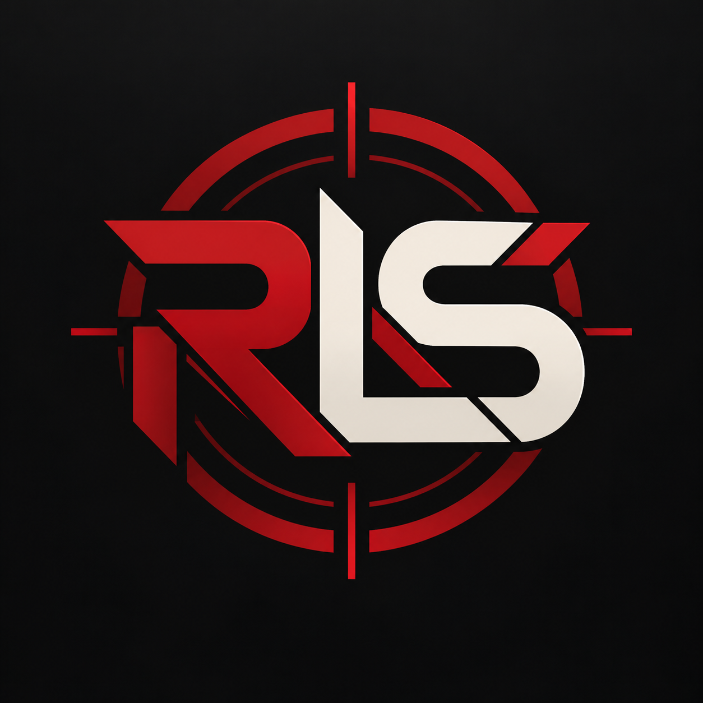

  
  <h1>Red’s Limited Sniper</h1>
  
Roblox limited resale sniping · Invite-only access

  
<a href="https://discord.gg/ZkN4QeJrSm"><strong>Join Discord to enquire about access →</strong></a>

## Interested in running RLS?

**Access to run Red’s Limited Sniper is invite-only.**

Join our Discord and open a private ticket in **#enquiries** to introduce yourself, ask questions and discuss access. Joining the community is open to everyone; access to the sniper is by invitation.

We also welcome enquiries about collaboration, sponsorship and funding through private tickets.

**[Enquire on Discord →](https://discord.gg/ZkN4QeJrSm)**

## See the project in action

Our public **#snipes** feed shares live purchase cards with item images, prices paid, deal percentages, estimated net returns, next listings and sell-speed indicators.

You can also follow selected development updates, discuss limiteds and trading, or join the general chat.

## About RLS

Red’s Limited Sniper is a privately developed project focused on Roblox limited-item resale sniping. This repository is its public information page. The software and source code remain private, with no public download.

---

RLS is an independent community project and is not affiliated with or endorsed by Roblox.
